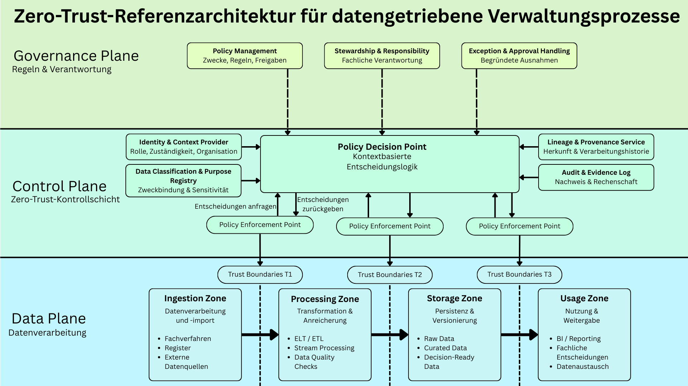
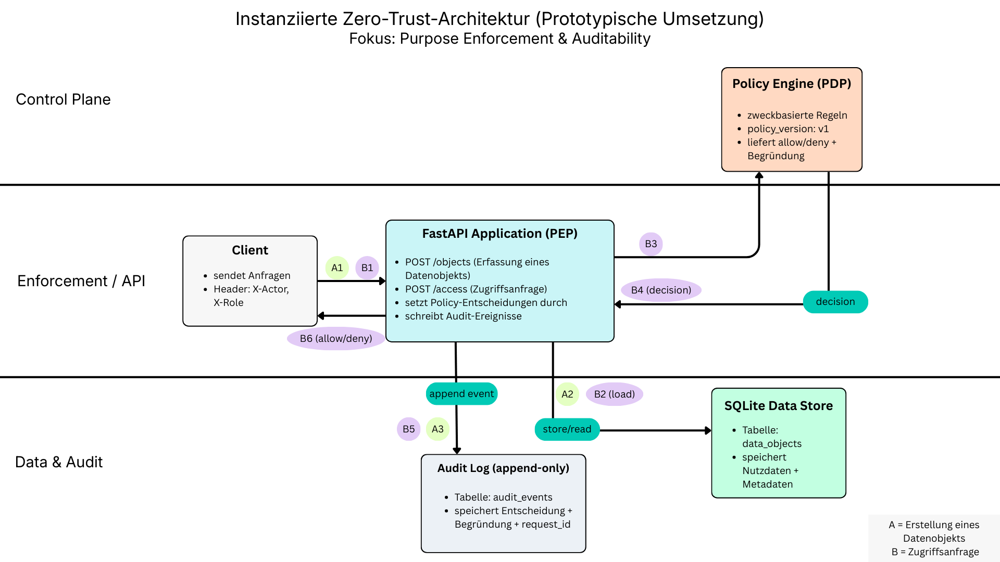

# Zero Trust Referenzarchitektur – Instanziierungsdemo

## Projektziel

Dieses Repository enthält die prototypische Instanziierung einer im Rahmen einer Design Science Research (DSR) entwickelten Zero-Trust-Referenzarchitektur für datengetriebene Behördenprozesse.

Ziel der Demo ist die praktische Umsetzung ausgewählter Mechanismen der Referenzarchitektur. Im Fokus stehen:

- Zweckbindung auf Datensatzebene (Purpose Enforcement)
- Policy-basierte Zugriffskontrolle
- Revisionsfähige Auditierbarkeit entlang des Datenflusses

Die Demo stellt kein Produktivsystem dar, sondern dient als **Proof of Concept** zur Demonstration der grundsätzlichen Umsetzbarkeit der konzeptionellen Architekturannahmen.

---

## Architekturüberblick

Die Instanziierung bildet folgende zentrale Komponenten ab:

- **PEP (Policy Enforcement Point)** – FastAPI Anwendung (`src/app.py`)
- **PDP (Policy Decision Point)** – Policy-Modul (`src/policy.py`)
- **Data Store** – SQLite Datenbank (`src/db.py`)
- **Audit Plane** – Append-only Audit Logging (`src/audit.py`)
- **DataObject Model** – Pydantic Validierung mit Pflicht-Metadaten (`src/models.py`)

### Grundprinzip

Jeder Datensatz wird als „Policy-Objekt“ mit verpflichtenden Metadaten (z. B. `purpose`, `policy_version`) behandelt.  
Zugriffe erfolgen ausschließlich nach Policy-Entscheidung.  
Jede relevante Aktion wird revisionsfähig protokolliert.

---

## Referenzarchitektur (Konzeptionelles Modell)

Die folgende Abbildung zeigt das vollständige konzeptionelle Referenzmodell.


---

## Instanziierung (Slim Demo-Architektur)

Die folgende Abbildung zeigt die konkret instanziierten Kernmechanismen dieser Demo.



---

## Technologie-Stack

- Python 3.12+
- FastAPI 
- Uvicorn
- Pydantic
- SQLite

---

## Scope & Abgrenzung

Diese Instanziierung ist bewusst schlank gehalten, da sie im Rahmen einer Bachelorarbeit als Proof of Concept dient.

Implementiert werden ausschließlich die Mechanismen, die notwendig sind, um die Kernannahmen der Referenzarchitektur nachweisbar zu demonstrieren:

- Datenobjekte als Policy-Objekte mit verpflichtenden Metadaten
- Policy Decision & Enforcement (zweckbasierte Zugriffskontrolle)
- Revisionsfähiges Audit Logging

### Nicht instanziiert (out of scope)

- Vollständiges Identity- und Access-Management (IAM/SSO)
- Externe Policy Engines (z. B. OPA)
- Message Broker / Event Streaming
- Verschlüsselung / Key Management
- Deployment-, Skalierungs- oder High-Availability-Konzepte

Diese Bestandteile sind Teil der Referenzarchitektur, werden hier jedoch zugunsten eines fokussierten und evaluierbaren Artefakts nicht umgesetzt.

---

## Projektstruktur
docs/ → Design- und Architekturartefakte (Scope, Flows, Policies, Evaluation)
src/ → Implementierung (API, Policy, DB, Audit)
tests/ → Validierungsszenarien (geplant)
scripts/ → Hilfsskripte (z. B. DB-Initialisierung)


---

## Setup

### 1) Repository klonen
```bash
git clone git@github.com:TomWa98/zta-pipeline-demo.git
cd zta-pipeline-demo

### 2) Virtuelle Umgebung erstellen
```bash
python3 -m venv .venv
source .venv/bin/activate
```

### 3) Abhängigkeiten installieren
```bash
pip install -r requirements.txt
```

### 4) Datenbank initialisieren
```bash
python scripts/init_db.py
```

### 5) Anwendung starten
```bash
uvicorn src.app:app --reload
```

Standardmäßig ist die API unter:

http://127.0.0.1:8000

erreichbar (sofern Port 8000 frei ist).

Die Swagger-UI befindet sich unter:
http://127.0.0.1:8000/docs


---


## Demonstrationsszenarien
Die Demo basiert auf dokumentierten Szenarien:

Erstellen eines Datenobjekts mit Pflicht-Metadaten

Zugriff mit erlaubter Rolle und passendem Zweck (Allow)

Zugriff mit unpassendem Zweck oder unberechtigter Rolle (Deny)

Für jede relevante Aktion wird ein Audit-Event in der Tabelle audit_events erzeugt.

### Entscheidungsnachvollziehbarkeit
Die Entscheidungsnachvollziehbarkeit erfolgt über:

decision (allow / deny)

reason

policy_version

request_id

Die vollständigen Szenarien sind in docs/05_evaluation.md dokumentiert.


---

## Wissenschaftlicher Kontext
Die Instanziierung erfolgt im Sinne des „Design & Development“-Schritts der Design Science Research Methodology.

Ziel ist die Demonstration der funktionalen Umsetzbarkeit ausgewählter Architekturmechanismen in einem reproduzierbaren Prototyp.